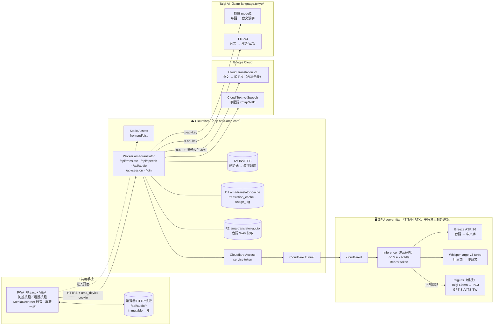
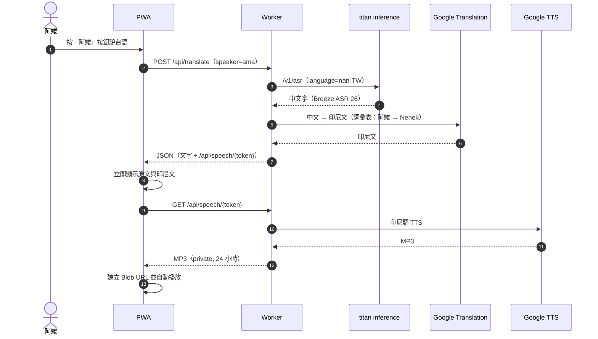
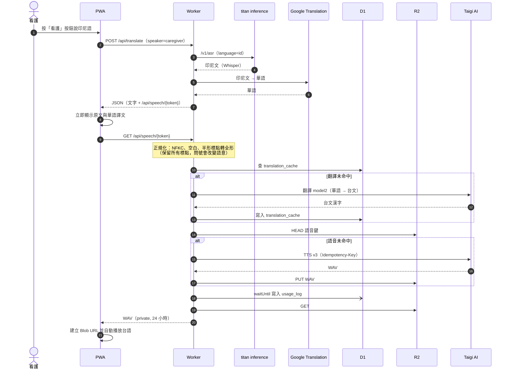
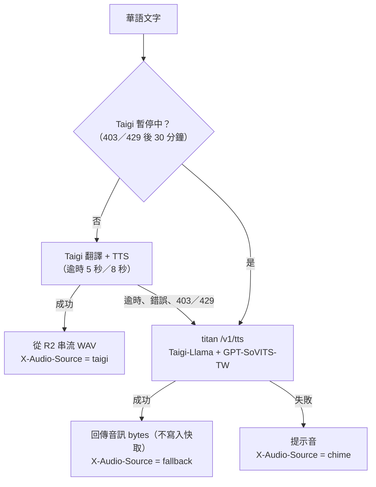

# 阿嬤的翻譯機

台語 ↔ 印尼語的手機 PWA 口譯工具。阿嬤（台語）與印尼看護共用一支手機，各自按自己的大按鈕說話；系統辨識、翻譯，並播放對方語言的語音。

- 正式網址：<https://app.ama-ama.com>（需邀請連結啟用裝置）
- 規劃與決策紀錄：[`docs/plan.md`](docs/plan.md)
- 前後端 API 契約：[`docs/api-contract.md`](docs/api-contract.md)
- 自架推論服務契約：[`docs/inference-contract.md`](docs/inference-contract.md)

## 系統架構



### 元件說明

| 元件 | 位置 | 職責 |
| ---- | ---- | ---- |
| PWA | `frontend/` | 錄音、上傳、播放、對話歷史、錯誤提示；不知道底層用哪個模型 |
| Worker | `worker/` | 前端託管與唯一的 `/api`；裝置驗證、先回傳 ASR／翻譯文字，再由 `/api/speech` 編排 TTS、兩層快取與失敗備援 |
| KV `INVITES` | Cloudflare | 邀請碼（一年效期，可撤銷）；裝置以 HMAC 簽章的 `ama_device` cookie 啟用 |
| D1 `ama-translator-cache` | Cloudflare | `translation_cache`：正規化華語 → Taigi 台文；`usage_log`：每句的命中狀態與來源 |
| R2 `ama-translator-audio` | Cloudflare | Taigi 台語 WAV，鍵為 SHA-256（台文 + model + voice + speed + 版本） |
| inference | `inference/`，titan | 自架 ASR（Breeze ASR 26、Whisper）與台語 TTS 備援的轉接 |
| taigi-tts | `taigi-tts/`，titan | 備援台語 TTS：Taigi-Llama 產生 POJ，GPT-SoVITS-TW 合成 |
| Google Cloud | 外部 | 中文 ↔ 印尼文翻譯、印尼語 TTS |
| Taigi AI | 外部（付費） | 看護 → 阿嬤主路徑：華語 → 台文、台語 TTS |

## 翻譯流程

### 阿嬤 → 看護（台語 → 印尼語）



### 看護 → 阿嬤（印尼語 → 台語）



### 失敗備援



照護安全：吃藥、疼痛、跌倒等內容只做翻譯與顯示，系統不做任何自動判斷。

## 快取與成本

- 「同一句話只付一次錢」：翻譯快取在 D1，語音快取在 R2，兩層都永久保存，不做汰換。
- 前端完整取得語音後建立 Blob URL；「再聽一次」與歷史重播優先使用同一個 Blob URL，不會重複呼叫 `/api/speech` 或 Taigi。
- 查看統計：在 `worker/` 執行 `pnpm cache-stats`；或在 Cloudflare 後台 **Storage & databases → D1／R2** 瀏覽。
- R2 免費額度 10 GB（約 6 萬句以上）；建議在 Cloudflare **Notifications → Usage Based Billing** 設定 8 GB 提醒。

## 目錄結構

```
frontend/   React + Vite + TypeScript + PWA（pnpm）
worker/     正式 API 後端 + 前端託管：Cloudflare Worker（TypeScript、wrangler、pnpm）
inference/  自架模型推論服務（titan），Python 3.12 + FastAPI（uv）
taigi-tts/  備援台語 TTS 容器（titan）
backend/    Python FastAPI；本機開發參考，正式環境已由 worker/ 取代
deploy/     docker compose、cloudflared、GPU server 部署
docs/       規劃、API 契約、調研報告
poc/        概念驗證
```

## 開發與部署

```sh
# 前端
pnpm --dir frontend install && pnpm --dir frontend dev

# Worker：測試、建置、部署（部署前會先建置 frontend/dist）
pnpm --dir worker test
pnpm --dir worker run deploy
```

憑證一律走環境變數或 Worker secrets，不進版控；設定方式見 [`worker/README.md`](worker/README.md) 與 [`deploy/gpu-server/README.md`](deploy/gpu-server/README.md)。
